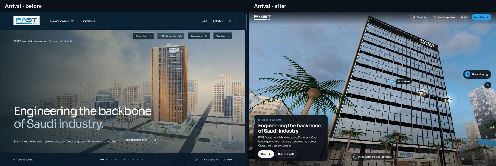
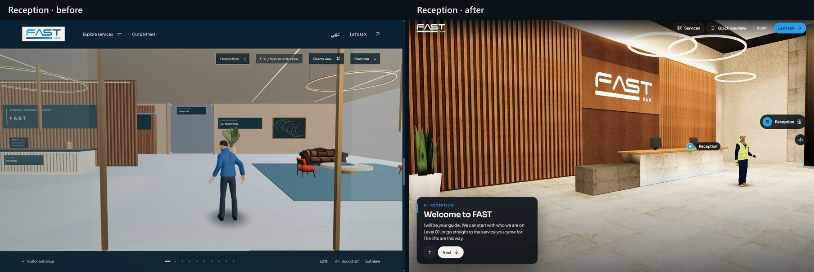
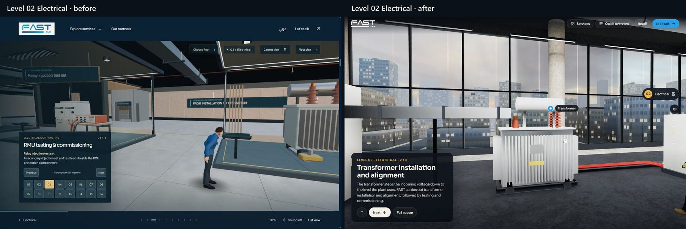
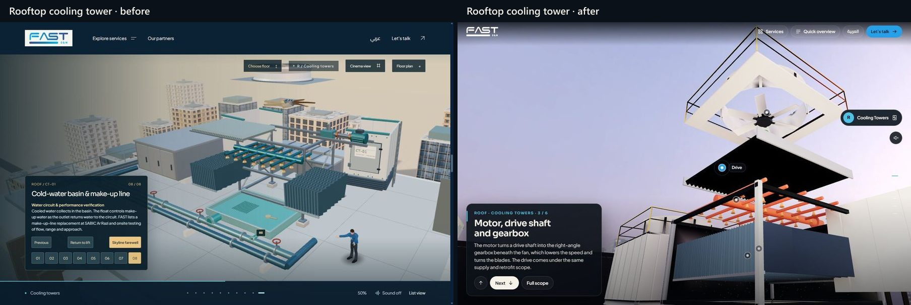
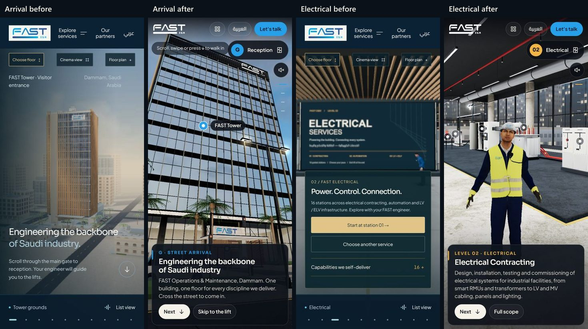

# Performance: old build vs. this one

Both builds were served the same way and driven by the same script, on the same machine, back to back.
Raw results are in `docs/perf/` (`measure-old.json`, `measure-new.json`, `test-report.json`).

## Conditions

| | |
| --- | --- |
| Machine | Windows 11 laptop, Intel Core i7-14650HX, Chrome (installed, headed) |
| GPU used by Chrome | Intel UHD integrated graphics (ANGLE / Direct3D 11) — not the discrete card |
| Server | `tools/serve.mjs`: static files with gzip from `127.0.0.1`, same base path as GitHub Pages (`/Fast-3d/`), HTTP cache disabled |
| Old build | `main` at `a4da304`, built with its own `npm run build` |
| New build | this branch, `npm run build` |
| Desktop profile | 1440 × 900, device pixel ratio 1, mouse wheel |
| Phone profile | 390 × 844, device pixel ratio 3, touch input, Android user agent, **DevTools 4× CPU throttle** |
| Script | `tools/measure.mjs`: load, walk the arrival with real wheel / touch input, take the lift to Electrical, walk that floor. Frame times come from `requestAnimationFrame` deltas. |

There is no network delay in this setup, so load times are dominated by parsing, decoding and shader
compilation. On a real connection the difference in download size (below) adds to the gap.

## Loading

| | Old | New |
| --- | --- | --- |
| Download before anything is usable | 11,514 KB, 141 requests | **263 KB** (headline, services, contact, language) |
| Time to first usable view, desktop | 11.5 s (loader covers the page) | **0.07 s** |
| Time to first usable view, phone profile | 47.7 s | **0.6 – 0.8 s** |
| Download until the 3D arrival is interactive | 11,514 KB | **3,295 KB**, 36 requests |
| Time until the 3D arrival is interactive, desktop | 11.5 s | **1.1 s** |
| Time until the 3D arrival is interactive, phone profile | 47.7 s | **2.3 – 3.2 s** (three runs) |
| Total after arrival + one floor | 11,514 KB | 5,570 KB |
| JavaScript (gzip) | 524 KB | 42 KB interface + 178 KB 3D engine, loaded separately |

"First usable view" means the visitor can read what FAST does and reach any service, the contact sheet,
Arabic, or the quick overview. In the old build that was only possible once the loader finished. On the
live GitHub Pages site the old build took roughly 28 – 30 s behind its loader on this machine.

The shared floor shell and skyline are downloaded once, on the first lift ride. After that each floor
adds only its own exhibit model (0.2 – 0.6 MB), fetched when chosen and pre-fetched for the next floor
while the visitor is standing still.

## Frame pacing — desktop

Frame times in milliseconds (16.7 ms = 60 frames per second).

| | Old: avg / 95th / worst | New: avg / 95th / worst |
| --- | --- | --- |
| Scrolling the arrival | 27.2 / 33.5 / **217**, 101 frames over 33 ms | **16.7 / 16.9 / 18**, none over 33 ms |
| Lift ride + first 3 s on the floor | 19.3 / 17.1 / **483** | **16.7 / 17.0 / 33** |
| Scrolling the floor | 16.7 / 16.9 / 18 | 16.7 / 16.9 / 18 |

Across ten consecutive lift rides in the end-to-end test, each ride took 2.38 – 2.42 s and the worst
frame gap was 150 ms (first visit to Level 01, where the certificate walls are drawn); the others were
17 – 50 ms.

## Frame pacing — phone profile (4× CPU throttle)

| | Old: avg / 95th / worst | New: avg / 95th / worst (range over three runs) |
| --- | --- | --- |
| Scrolling the arrival | 54.9 / 166 / **1,850** | 24 – 34 / 67 – 100 / 150 – 267 |
| Lift ride + first 3 s on the floor | 54.3 / 117 / **1,067** | 27 – 33 / 83 – 117 / 233 – 283 |
| Scrolling the floor | 46.2 / 150 / 383 | 31 – 32 / 100 / 167 – 200 |
| Canvas actually rendered | 331 × 717 | 624 × 1,350 (3.5× the pixels) |
| Lift: choose floor → doors open on a ready scene | 2.6 s | 1.9 – 2.0 s covered, 2.6 – 2.8 s in total |

Read these as a stress test rather than as a phone. Chrome's CPU throttle slows the WebGL command
stream far more than a real phone does (a frame that costs 1.5 ms unthrottled cost about 44 ms
throttled). Without the throttle, the same 390 × 844 emulation held 60 frames per second. The new build
is roughly twice as smooth as the old one under the same handicap while drawing 3.5× the pixels, but it
is not 60 fps there, and I did not have a physical phone to settle what a mid-range handset really does.

## What made the difference

- **Lighting is baked.** Blender (Cycles) renders light and shadow into lightmaps and vertex colours; the
  browser runs no lights and no shadow maps.
- **One scene at a time.** The arrival is 1.4 MB of geometry; each floor loads on demand instead of
  everything sitting behind one loader.
- **The interface does not wait for 3D.** The 42 KB interface paints first, with a poster image, then
  hands over to the 3D view.
- **Floor changes reveal a ready scene.** While the lift doors are closed the next floor is loaded,
  its shaders are compiled off the main thread and one hidden frame is drawn, so the doors open on a
  scene that is already warm. The next floor is also warmed in the background once the visitor has
  stood still for about a second.
- **Scroll is a spring, not a page.** Input moves a virtual position along a camera rail with fixed
  stops, so pacing is the same on a wheel, trackpad, touch screen and keyboard, and the 8,100 px
  (arrival) and 27,000 px (Electrical) scroll distances of the old build are gone.
- **Adaptive resolution.** The engine lowers the pixel ratio when frames run long, checks whether that
  helped, and if it did not (the device is CPU-bound) gives the pixels back and drops pedestrians
  instead. If the device still struggles, the visitor is offered the quick overview.

### Tried and dropped

Merging static meshes that share a material at load time (fewer draw calls) was measured and removed:
on the throttled profile it changed frame times by a few percent either way, but doing the merge on the
main thread stretched the first lift ride from 2.7 s to 5.4 s.

## Functional test

`npm test` drives the production build through its real controls: **42 checks, all passing** on the
final build. It covers the street-to-reception walk, the lift selector, keyboard control, the About
viewer, the services menu, contact, Arabic and right-to-left layout, ten consecutive lift rides,
changing floor mid-ride, reversing mid-move, the rooftop ending (automatic drone pull-out and the
return to the roof), reduced motion, no-WebGL fallback, and the phone layout with swipe input.
Screenshots from the run are written to `artifacts/test/`.

## Before and after

| | |
| --- | --- |
| Arrival |  |
| Reception |  |
| Level 02 Electrical |  |
| Rooftop cooling tower |  |
| Phone |  |

## Reproducing

```bash
# old build: check out main in a second folder, build it there with BASE_PATH=/Fast-3d/
node tools/serve.mjs ../baseline/Fast-3d 4174 /Fast-3d/
# new build
BASE_PATH=/Fast-3d/ npm run build          # PowerShell: $env:BASE_PATH='/Fast-3d/'; npm run build
node tools/serve.mjs dist 4173 /Fast-3d/
node tools/measure.mjs                     # --only old|new, --profile desktop|mobile
npm test
node tools/compare-shots.mjs               # before / after images into docs/media
```

In Git Bash on Windows, prefix the build with `MSYS2_ENV_CONV_EXCL=BASE_PATH` so the shell does not
rewrite the base path.

## Not verified

- **A physical phone or tablet.** All phone results are Chrome emulation on a laptop with an integrated
  GPU. Touch input, layout, Arabic and the lift were exercised that way; thermal behaviour, Safari on
  iOS and low-memory Android devices were not.
- **Safari and Firefox.** Only Chrome was run.
- **A slow network.** Download sizes are measured; times on 4G were not.
- **Sound.** The optional ambience is off by default. It was not listened to and judged.
- **The guide's motion in real time.** Walking, pointing and the idle and talk loops were judged mostly
  from stills and frame sequences; the talk loop has a visible seam where it repeats.
